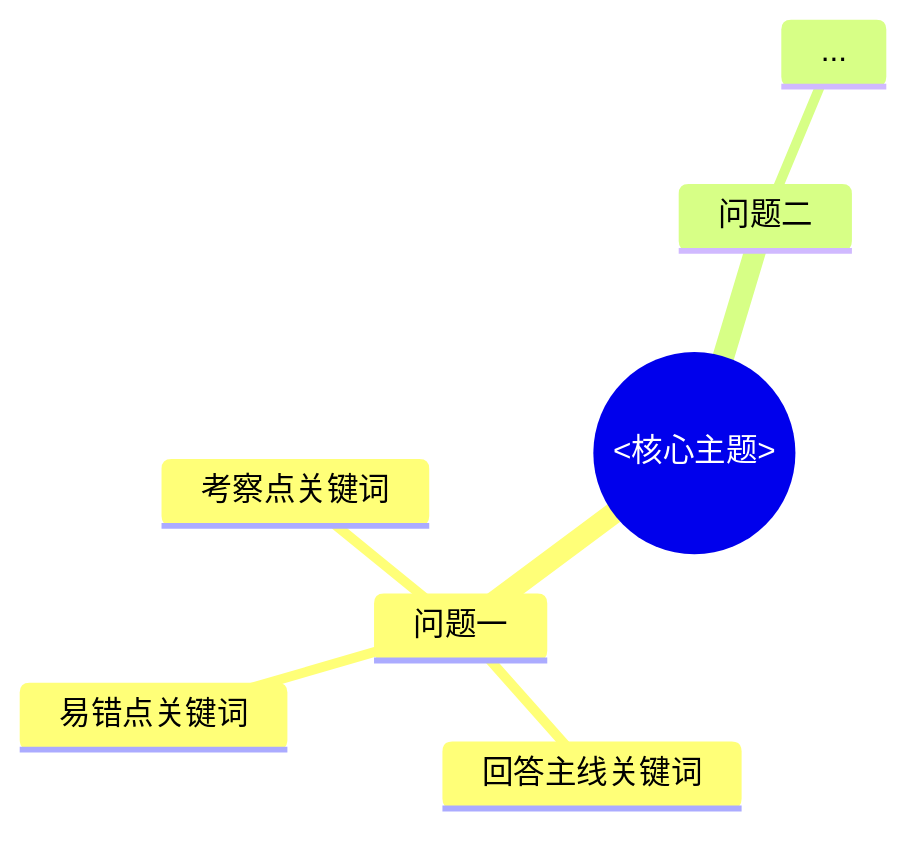
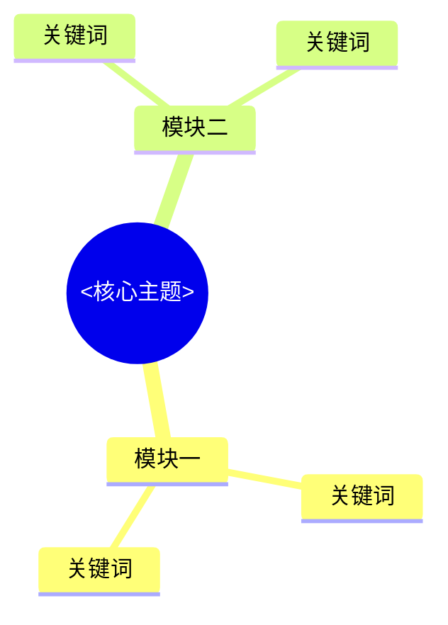

# 笔记输出模板

## Frontmatter

```yaml
---
title: "面试题｜整理后的标题"
source: "https://www.douyin.com/video/<video_id>"
source_id: "<video_id>"
source_title: "抖音原始标题"
platform: "抖音"
author: "博主名"
published: "YYYY-MM-DD"
created: YYYY-MM-DD
duration: "mm:ss"
tags:
  - "视频笔记"
  - "抖音"
  - "面试题"   # 普通学习视频改为“学习”
  - "主题标签1"
---
```

## 面试题模式

```markdown
# <title>

> 一句话总结：<用 1–2 句话概括视频的核心结论>

## 思维导图



## 问答整理

### Q1. <整理后的问题> `[mm:ss–mm:ss]`

**考察点：** <面试官真正想确认什么>

**回答框架：**
1. <先给结论>
2. <再讲原因>
3. <最后给方案>
4. <收尾>

**口述回答：**
<300–600 字的完整口述稿。只基于视频内容展开，用自然段写，不写 bullet list；先结论，再解释原因，再给方案。>

**补充标准答案：**
<如果视频内容不足，补充视频没讲到的标准面试知识。必须明确写“以下为非视频内容，用于补全面试答案”。如果视频已经足够完整，写“暂无必要补充”。>

**追问 / 易错点：**
- <常见追问>
- <容易答错的边界>
- <可加分的补充>

## 可行动项 / 启发
- <可以马上实践或继续查证的内容>

## 来源
[抖音原视频](<source>)
```

## 普通学习模式

```markdown
# <title>

> 一句话总结：<概括>

## 思维导图



## 核心要点
- <3–7 条>

## 详细梳理
<按逻辑主题展开，不按发言顺序复述>

## 可行动项 / 启发
- <可以马上实践或继续查证的内容>

## 来源
[抖音原视频](<source>)
```

## 硬性要求

- 正文使用简体中文；技术名词保留通用英文写法。
- 不把完整逐字稿写进笔记。
- 每题尽量带视频时间戳。
- 思维导图只放 2–5 个关键词，不塞长句。
- 面试题模式每道题至少保留“考察点、回答框架、口述回答、补充标准答案”。
- 普通学习模式至少保留“核心要点、详细梳理”。
- 文件名由 `commit` 命令根据 frontmatter 的 `title` 自动生成。
